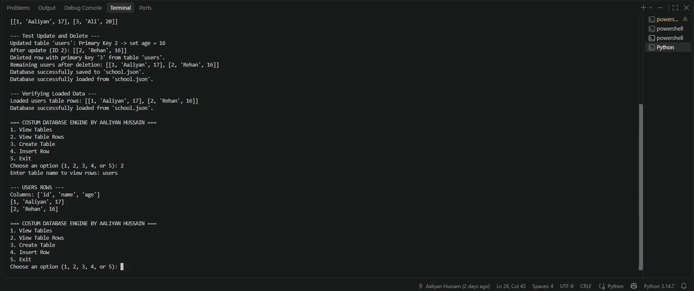

# Custom In-Memory Relational Database Engine

A custom database engine built from scratch in Python without using any external libraries. I built this to understand how databases manage data under the hood, enforce table rules, and prevent runtime crashes.

---

## 🚀 Demo

---

## What It Does

* **Fast Primary Key Checks:** Uses set lookups to instantly check primary keys and prevent duplicate entries before saving.
* **Type Validation:** Enforces column data types (like `int` and `str`) during insertion to prevent table corruption.
* **CLI Input Handling:** Catches invalid menu options and missing tables so the terminal loop stays active without crashing.
* **JSON State Persistence:** Saves and loads table states to a local `school.json` file across sessions.
* **Zero Libraries:** Built completely with standard Python features to learn core logic from first principles.

---

## How I Built It

1. **Preventing Bad Data:** Instead of allowing bad inputs into the database and fixing them later, the engine checks types and keys before making any changes.
2. **Interactive Loop Control:** Wrapped user prompts in try-except blocks to catch runtime inputs like bad choices or non-existent table names smoothly.
3. **Clean Repository:** Added a `.gitignore` file to keep generated data files separate from the main source code.

---

## Quick Start

### 1. Run the Engine
py main.py

---

## Project Files

├── engine.py       # Core database logic, table rules, and JSON file saving
├── main.py         # Terminal interface, user menus, and error handling
├── .gitignore      # Ignores runtime database files (like school.json)
└── assets/
    └── demo.gif    # Demo animation of the terminal

---

## Why I Built This

I created this project while self-teaching Python and computer science fundamentals. It helped me practice low-level logic, data handling, and error handling before moving on to building larger software and game development projects.